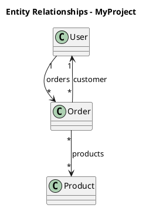
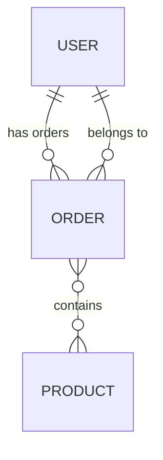

# Design: Diagram Export (PlantUML/Mermaid)

## Architecture Overview

```
┌─────────────────────────────────────────────────────────────┐
│                    Diagram Export System                     │
│                                                              │
│  ┌──────────────────────────────────────────────────────┐   │
│  │              DiagramExportService                     │   │
│  │                                                       │   │
│  │  ┌─────────────┐ ┌─────────────┐ ┌─────────────┐    │   │
│  │  │  PlantUML   │ │   Mermaid   │ │   Export    │    │   │
│  │  │  Generator  │ │  Generator  │ │   Options   │    │   │
│  │  └─────────────┘ └─────────────┘ └─────────────┘    │   │
│  └──────────────────────────────────────────────────────┘   │
│                            │                                 │
│                            ▼                                 │
│              ┌─────────────────────────┐                    │
│              │   ExportDialog (UI)     │                    │
│              │   - Format selection    │                    │
│              │   - Filter options      │                    │
│              │   - Preview pane        │                    │
│              └─────────────────────────┘                    │
└─────────────────────────────────────────────────────────────┘
```

## Components

### 1. ExportOptions Record

```java
public record ExportOptions(
    DiagramFormat format,
    boolean includeAcceptedOnly,
    boolean includePending,
    double minConfidence,
    Set<String> relationTypes,
    boolean showConfidenceScores,
    boolean colorByPackage
) {
    public enum DiagramFormat {
        PLANTUML, MERMAID
    }
    
    public static ExportOptions defaults() {
        return new ExportOptions(
            DiagramFormat.PLANTUML,
            false, true, 0.0,
            Set.of("OneToOne", "OneToMany", "ManyToOne", "ManyToMany"),
            false, true
        );
    }
}
```

### 2. DiagramExportService

```java
public class DiagramExportService {
    public String generatePlantUML(List<RelacionDetectada> relations, 
                                   ExportOptions options);
    public String generateMermaid(List<RelacionDetectada> relations,
                                  ExportOptions options);
    public void exportToFile(String content, Path filePath);
    public void copyToClipboard(String content);
}
```

### 3. PlantUML Output Format



### 4. Mermaid Output Format



### 5. Cardinality Mapping

| Relation Type | PlantUML | Mermaid |
|--------------|----------|---------|
| OneToOne | "1" -- "1" | \|\|--\|\| |
| OneToMany | "1" --> "*" | \|\|--o{ |
| ManyToOne | "*" --> "1" | }o--\|\| |
| ManyToMany | "*" --> "*" | }o--o{ |

### 6. ExportDialog UI

```
┌─────────────────────────────────────────────┐
│         Exportar Diagrama                    │
├─────────────────────────────────────────────┤
│ Formato: [PlantUML ▼]                       │
│                                              │
│ Filtros:                                     │
│ ☑ Solo relaciones aceptadas                 │
│ ☑ Incluir pendientes                        │
│ Confianza mínima: [0.5____]                 │
│                                              │
│ Tipos: ☑ 1:1 ☑ 1:N ☑ N:1 ☑ N:M            │
│                                              │
│ Opciones:                                    │
│ ☐ Mostrar scores de confianza               │
│ ☑ Colorear por paquete                      │
├─────────────────────────────────────────────┤
│ Preview:                                     │
│ ┌─────────────────────────────────────────┐ │
│ │ @startuml                               │ │
│ │ title Entity Relationships              │ │
│ │ class User { }                          │ │
│ │ class Order { }                         │ │
│ │ User "1" --> "*" Order                  │ │
│ │ @enduml                                 │ │
│ └─────────────────────────────────────────┘ │
├─────────────────────────────────────────────┤
│ [Copiar] [Guardar...] [Cancelar]            │
└─────────────────────────────────────────────┘
```

## Correctness Properties

### Property 1: Valid PlantUML Syntax
Generated PlantUML should be parseable without syntax errors.
- **Validates**: Requirement 1.1

### Property 2: Valid Mermaid Syntax
Generated Mermaid should be parseable without syntax errors.
- **Validates**: Requirement 2.1

### Property 3: All Entities Included
Every unique class from relations should appear in the diagram.
- **Validates**: Requirements 1.2, 2.2

### Property 4: Cardinality Correctness
Relation types should map to correct cardinality notation.
- **Validates**: Requirements 1.3, 2.3

### Property 5: Filter Application
Export with filters should only include matching relations.
- **Validates**: Requirements 3.1, 3.2, 3.3
